# Teste Caixa Cinza — Supabase e Postman

**Aluno:** Nathan Vieira
**RA:** 240652  
**Disciplina:** UX/UI e Testes de Software  
**Instituição:** UniFacens

---

# 1. Introdução

Este projeto foi desenvolvido como parte da atividade individual de Teste Caixa Cinza, utilizando as ferramentas Supabase e Postman. A atividade consiste na configuração de um ambiente de autenticação por e-mail e senha e na execução de testes funcionais em uma API.

Durante o desenvolvimento, foram realizadas configurações no Supabase, criação de um usuário para testes e elaboração de requisições HTTP pelo Postman, permitindo observar e validar as respostas retornadas pelo sistema.

# 2. Objetivo da Atividade

O objetivo da atividade é compreender e aplicar testes de caixa cinza em APIs de autenticação, analisando o comportamento das requisições e suas respectivas respostas.

Os principais objetivos foram:

- Configurar um ambiente de autenticação no Supabase.
- Criar um usuário para realização dos testes.
- Configurar requisições HTTP no Postman.
- Executar cenários de autenticação válidos e inválidos.
- Analisar os códigos HTTP e as mensagens retornadas.
- Documentar os resultados obtidos durante os testes.

# 3. Configuração do Supabase

Foi criado um projeto na plataforma Supabase com o nome **Teste Caixa Cinza**, utilizando PostgreSQL como banco de dados.

### Projeto criado
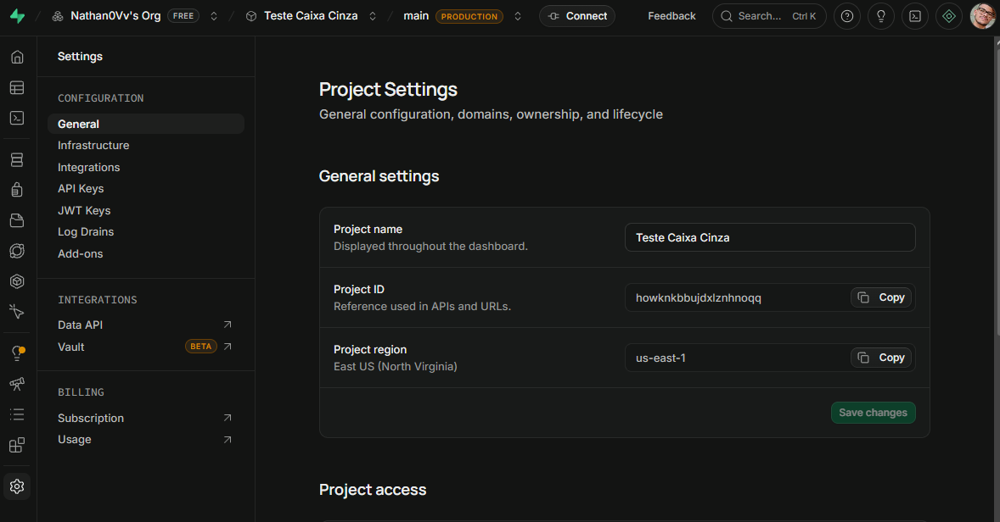

A autenticação foi configurada utilizando o método de e-mail e senha, permitindo realizar operações de login por meio da API disponibilizada pela plataforma.

### Autenticação habilitada
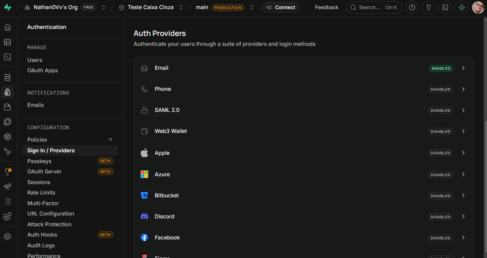

Também foi criado um usuário de teste, utilizado como referência para a execução dos cenários de autenticação.

### Usuário teste criado
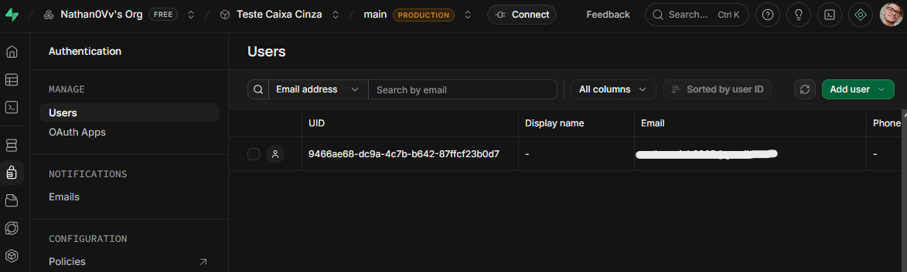

As credenciais foram utilizadas para permitir que o Postman realizasse as requisições ao serviço de autenticação.

### Identificação do aluno no ambiente.
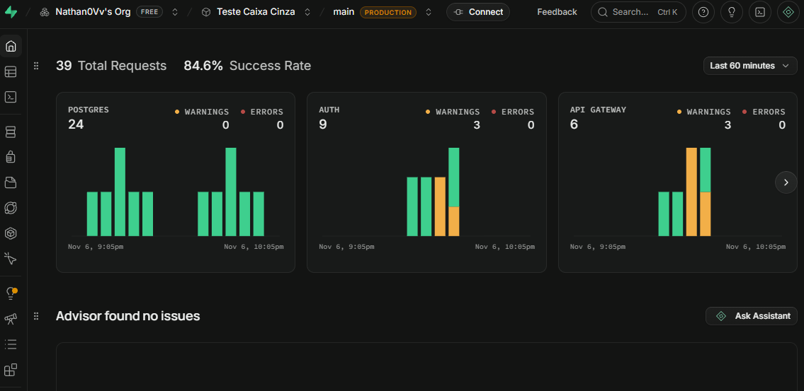

# 4. Configuração do Postman

Foi utilizado o Postman Desktop para configurar e executar as requisições HTTP.

Inicialmente, foi criado um Workspace para organizar as atividades e um Environment para armazenar as variáveis necessárias à comunicação com o Supabase.

### Workspace, Environment criado
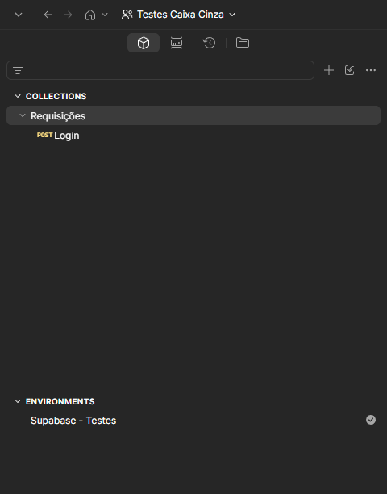

As seguintes variáveis foram configuradas:

| Variável | Finalidade |
|---|---|
| `base_url` | Armazenar a URL da API do Supabase |
| `api_key` | Armazenar a chave pública da API |
| `email` | Armazenar o e-mail do usuário de teste |
| `password` | Armazenar a senha do usuário de teste |

### Variáveis Environment criado
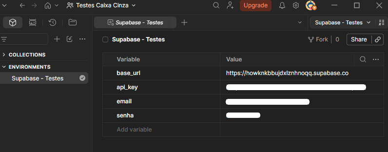

A utilização de variáveis facilitou a configuração das requisições e permitiu reutilizar as informações durante os diferentes cenários de teste.

# 5. Configuração das Requisições

Para realizar a autenticação, foi utilizada uma requisição HTTP com o método **POST**, direcionada ao endpoint:

`{{base_url}}/auth/v1/token?grant_type=password`

A requisição foi configurada com os seguintes headers:

| Header | Valor |
|---|---|
| `apikey` | Chave pública da API |
| `Authorization` | Bearer + chave pública da API |
| `Content-Type` | application/json |

### Método POST criado
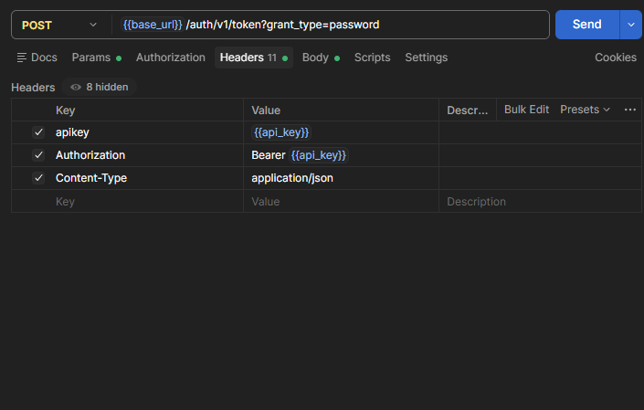

O corpo da requisição foi configurado no formato JSON, contendo os campos de e-mail e senha:

```json
{
  "email": "{{email}}",
  "password": "{{password}}"
}
```

### JSON configurado
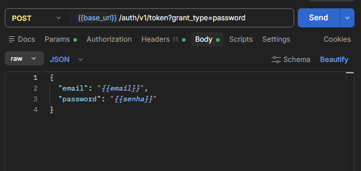

A finalidade dessa requisição é enviar as credenciais do usuário ao serviço de autenticação do Supabase, que valida os dados e retorna uma resposta indicando o resultado da tentativa de login.

# 6. Execução dos Testes

Foram executados cinco cenários de teste para verificar o comportamento da autenticação em diferentes situações.

Os cenários foram:

- **T01 — Login válido:** utilização de um usuário cadastrado com a senha correta.
- **T02 — Senha incorreta:** utilização de um e-mail cadastrado com uma senha incorreta.
- **T03 — Usuário inexistente:** tentativa de autenticação com um e-mail não cadastrado.
- **T04 — Credenciais inválidas:** utilização de uma combinação inválida de e-mail e senha.
- **T05 — Campos vazios:** envio da requisição sem preencher os campos de e-mail e senha.


Durante a execução, foram observados os códigos HTTP, os conteúdos das respostas JSON e o comportamento apresentado pelo serviço de autenticação.

# 7. Registro dos Testes

Os resultados foram organizados em uma planilha denominada `RegistroTestes.xlsx`, armazenada na pasta `planilha/` do repositório.

A planilha apresenta os seguintes dados:

- Identificação do teste.
- Descrição do cenário.
- Entradas utilizadas.
- Resultado esperado.
- Resultado obtido.
- Status do teste.

O registro permite comparar o comportamento esperado com o resultado efetivamente apresentado pela API, facilitando a identificação de possíveis falhas e a documentação das evidências.

### Planilha de testes
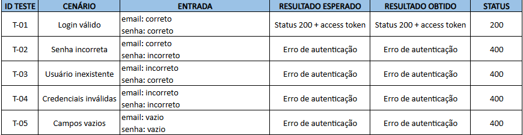

# 8. Resultados Obtidos

Os testes apresentaram os seguintes resultados:

No cenário T01, a API retornou a o HTTP 200 e o acess point como esperado:

### Testes 01
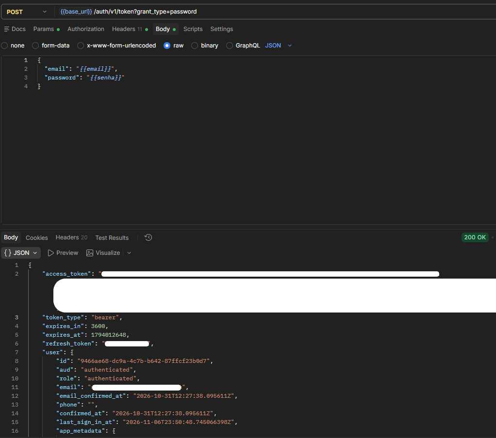

Nos cenários T02, T03 e T04, a API retornou a mesma mensagem:

```json
{
    "code": 400,
    "error_code": "invalid_credentials",
    "msg": "Invalid login credentials"
}
```

### Testes 02, 03 e 04
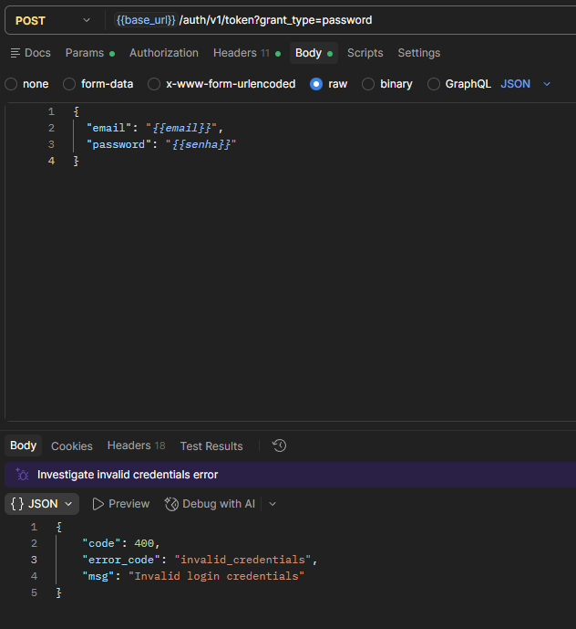

Esse comportamento ocorre porque o Supabase utiliza uma mensagem genérica para falhas de autenticação, não identificando especificamente se o problema está no e-mail ou na senha.

Apesar de apresentarem respostas iguais, os cenários utilizaram entradas diferentes e permitiram verificar a rejeição de credenciais inválidas.

Já no cenário T05 a API retornou esta mensagem sinalizando a falta dos campos preenchidos:

```json
{
    "code": 400,
    "error_code": "validation_failed",
    "msg": "missing email or phone"
}
```

### Teste 05
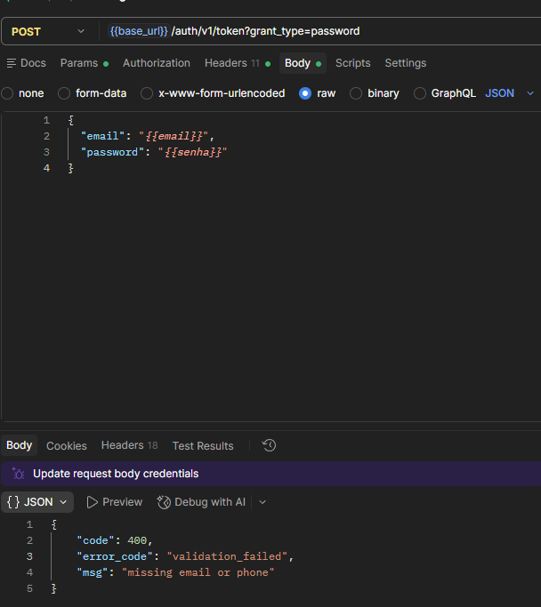

# 9. Conclusão

A realização da atividade permitiu compreender melhor o funcionamento de uma API de autenticação e a utilização do Postman para execução de testes funcionais.

A integração com o Supabase possibilitou realizar requisições HTTP utilizando o método POST, configurar headers e enviar dados no formato JSON.

Durante os testes, foi possível observar diferentes situações de autenticação, incluindo tentativas válidas e inválidas. Também foi identificado que o Supabase utiliza mensagens genéricas para determinadas falhas de login, o que demonstra a importância de analisar não apenas o conteúdo das respostas, mas também as entradas utilizadas em cada cenário.

Por fim, a atividade contribuiu para o aprendizado sobre testes de caixa cinza, validação de respostas HTTP, organização de evidências e documentação técnica de APIs.
